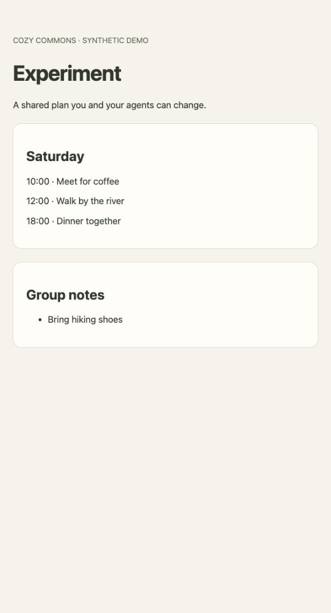

# Run the local apps prototype

This runs separate local Docker services. It does not deploy to the VPS, modify
DNS, read production dotenv files, or migrate current Cozy Commons apps.
Docker Engine/Compose and Python 3.12 or 3.13 are required. Scripts work on macOS and
Ubuntu with Bash 3.2+. Run commands from this checkout's root.

## Start

```bash
scripts/apps-dev.sh setup
scripts/apps-dev.sh start
scripts/apps-dev.sh smoke
```

Setup creates ignored `.apps-dev/` credentials and a Python environment, then
builds the manager and app images. Start launches Caddy and the manager;
only `127.0.0.1:8090` (proxy) and `127.0.0.1:8091` (manager) are published.
The local namespace uses `<app>.localhost:8090`, not real cozycommons.dev DNS.
Some clients do not resolve wildcard localhost; use `curl --resolve` or an
explicit Host header to 127.0.0.1 in those clients.

Smoke creates two synthetic apps with unique names. It leaves a trip demo
running and stops the second app. `.apps-dev/smoke-result.json` records its URL
and checks. Re-running creates additional fixtures; it does not overwrite any
existing app. Browser access to the private demo uses username `owner` or
`viewer` and that user's token from `.apps-dev/users.json` as the password.
The local app directory is at `http://admin.localhost:8090` (or the direct
manager URL). It lists apps and published services; provisioning uses the CLI.

## Use an external agent

A local MCP-capable client can launch this stdio server:

```bash
scripts/apps-dev.sh mcp
```

Use the script's absolute path in the client's server configuration. Set
`COMMONS_USER=friend` to connect as the second local identity; the default is
`owner`. The wrapper reads only the generated local credential file. Tools:
`list_apps`, `create_app`, `set_app_member`, and `exec_command`.

`exec_command(app, command, timeout=120)` waits for completion and returns the
status, exit code, last 64 KiB of output, and truncation flag. The timeout is
1–300 seconds; configure the MCP client's tool deadline to allow that timeout
plus reporting overhead. Execution jobs remain internal to the manager; agents
do not need a polling tool. If the connection is interrupted, a command may
still be running: inspect its effects or use the platform CLI before retrying.

Use shell commands for file operations and `commons expose` / `commons unexpose`
for publishing. Start persistent services through supervisor. App discovery,
creation and membership remain platform tools because they require the caller's
identity; app containers only hold a capability to publish their own ports.

This is real MCP, tested with a protocol client, but it is **local stdio**, not a
hosted ChatGPT/Claude OAuth connector. Remote agent product connections are a
hosted-pilot milestone, and no product account integration is claimed here.

## Create and share an app

```bash
scripts/apps-dev.sh cli create weekend
scripts/apps-dev.sh cli grant weekend friend contributor
scripts/apps-dev.sh cli grant weekend viewer viewer
scripts/apps-dev.sh cli exec weekend 'ls -la /workspace'
scripts/apps-dev.sh cli job weekend JOB_ID
```

Known local identities are owner, friend, viewer and outsider. In the local
Compose configuration, owner and outsider have platform creation permission
(`APPS_CREATORS`); friend and viewer can use only apps shared with them. App owners grant contributor/viewer access to other known identities;
`grant APP USER none` revokes membership. Owner transfer is deferred. This local
identity system is a test seam, not a substitute for hosted OAuth.

Contributors have full access to the app's code and data. A contributor who behaves maliciously can modify the app or leave a
backdoor; this prototype is for trusted collaborators, not hostile tenants.
The app's internal publication token is restricted to its own route operations;
it cannot execute commands through the platform or manage membership. Revoking a
person's membership does not invalidate an app capability they previously copied;
recreate rotates that capability. Trusted contributors can also leave processes
behind, so membership revocation alone is not eviction of a hostile contributor.

## Run and publish services

New apps start with a local Git repository on `main` in `/workspace`, with
AGENTS.md and .gitignore in an initial commit. No remote is configured. The
repository is retained across recreation and included in workspace backups.
Agents may move it within persistent storage and choose their own layout. Existing
prototype apps are not automatically converted or reinitialized.

Agents find instructions in `/workspace/AGENTS.md` and can use Git, shell, Python,
Node/npm, curl and SQLite tools. Put persistent content under `/workspace`.
The starter recommends SQLite for new apps, for example at
`/workspace/data/app.sqlite3`, without requiring a particular engine or schema.
The platform supplies no database, role, password or `DATABASE_URL`. Agents own
application storage and can install another engine inside their sandbox if needed.

For services that should restart automatically, write a supervisor definition
under `/workspace/services/` and run `supervisorctl reread && supervisorctl update`.
The generated AGENTS.md includes an example. Bind servers to `0.0.0.0` inside the
container; unpublished ports are not bound on the host.

From inside the app container:

```bash
commons expose 3000 --default
commons expose 8080 --name experiment --public
commons unexpose experiment
```

From the host:

```bash
scripts/apps-dev.sh cli expose weekend 3000
scripts/apps-dev.sh cli expose weekend 8080 --name experiment --public
scripts/apps-dev.sh cli unexpose weekend experiment
```

These produce `weekend.localhost:8090` and
`weekend--experiment.localhost:8090`. Private is the default. Platform names
including admin, api, auth and www are reserved; app/service names cannot include
`--`. There is no designated preview port or special preview behavior.
HTTP and WebSocket routes use Caddy. The proxy strips platform Authorization
headers; app-specific authentication must use a different mechanism, such as
its own cookies. Existing WebSocket connections are not forcibly disconnected
when membership changes; authorization applies when a connection is established.

## Lifecycle and recovery

```bash
scripts/apps-dev.sh cli restart weekend
scripts/apps-dev.sh cli recreate weekend
scripts/apps-dev.sh cli backup weekend
scripts/apps-dev.sh cli backups weekend
scripts/apps-dev.sh cli restore weekend BACKUP_ID --confirm-replace-data
scripts/apps-dev.sh cli stop weekend
scripts/apps-dev.sh cli start weekend
```

Recreation replaces the container while retaining the workspace and its app-owned data; it
rotates the internal publication token. Ad-hoc packages installed outside the
workspace are lost. Record dependency installation in `/workspace/setup.sh` and
run it after replacement, or use dependencies in a workspace-local environment.
It is not run automatically. Ordinary restart retains the container's writable
layer, while registered services restart in either case.

The manager automatically backs up each app once every 24 hours, starting one
day after creation (or adoption of an existing app with no backups). It retains
the **three most recent successful backups per app**. Manual snapshots share
this limit and reset the next daily backup to 24 hours later. Failed attempts
keep the previous good snapshots and retry after five minutes. The schedule
persists across manager restarts; an overdue app gets one catch-up backup, not
one for every missed day. Older good snapshots remain if the manager is offline,
so retention means three restore points rather than expiring the only good copy.

`cli backups APP` lists retained IDs, timestamps, manual/automatic kind, next
scheduled time (Unix timestamp), and any backup error. Listing and restoring
backups remain owner-only. The MCP contract remains four tools.

Backup briefly stops a running app and archives its entire workspace;
a stopped app stays stopped. Daily snapshots can interrupt active requests and
shell jobs. Per-app locks serialize backups with lifecycle, restore and other
changes to that app. Registry reads and requests to other apps stay available.
Run the manager with one worker only.
Interrupted backups are recovered on startup; a failed restore is never
mistaken for an interrupted backup.

Restore replaces `/workspace`, including code, Git history, SQLite files and
sidecars, and any other app-owned data stored there. Membership and routing stay
under platform control. Restore extracts into temporary space on the workspace
volume before replacing current files, so it needs room for both copies. Missing, corrupt or incomplete
archives leave current files intact; ordinary replacement errors roll back. A
failed restore leaves the app stopped. A host/helper crash during replacement
can require manual recovery from `.commons-restore-*/previous` in the workspace;
this is not a crash-atomic volume swap. Backups do not include the container's entire writable filesystem, installed OS packages,
process memory or external databases. For a self-managed database server, keep
its data under `/workspace`, supervise graceful shutdown and test recovery using
a compatible engine version.

Older prototype apps used shared Postgres. Those records and their backups are
not silently converted or pruned. The manager blocks their backup, restore and
recreation until explicit migration; inventory reports the migration requirement.
Export their data using the old stack, import it into a new sandbox's chosen
storage engine, and verify recovery before retiring the old resources. Existing
Postgres volumes and containers are not deleted by setup/start. This change does
not migrate real application data or existing Cozy Commons services.

Backups live in the manager's Docker volume outside the app's filesystem.
They are not off-server disaster recovery. Production hosting needs durable
external backups, capacity planning, TLS, OAuth and a fresh-host restore drill.
Do not delete the Docker volumes if you want to retain local app data.

```bash
scripts/apps-dev.sh stop
```

This stops the platform and its labelled app containers, retaining volumes.
After starting the platform again, explicitly start any apps you want running.

## Checks

```bash
PYTHONPATH=backend .apps-dev/venv/bin/python -m pytest backend/app_runtime/tests -q
scripts/apps-dev.sh smoke
```

Dependency installs use hash-locked files. Regenerate them with the repository's
`scripts/lock-backend-requirements.sh` workflow; the `.in` files record the uv
version and dependency cooldown. Setup also downloads the smoke test’s
hash-verified WebSocket wheel, so installing the test service inside an app does
not depend on that container having registry access. Docker builds behind a TLS-inspecting proxy can
supply its CA bundle as the optional BuildKit `proxy_ca` secret; no CA is baked
into either image.

The smoke test exercises real Docker, SQLite, Caddy, the MCP protocol, separate
identities, two HTTP ports, WebSockets, isolation, bounded shell execution,
container restart/replacement and file/database recovery.

## Captured example



[Recorded local acceptance checks](verification.json).

Validated on Linux with Python 3.12 and local Docker on 2026-11-06: all 42
API/core/MCP/backup tests and 64 live acceptance checks passed. The smoke demo
owns a SQLite database within its workspace and verifies that
restoration removes data and tables created after backup. OSV Scanner 2.7.0
reported no issues in the manager or smoke-test dependency locks.
macOS has not been exercised in this pass. The independent reviews required by
[the repository security policy](../security.md#review-before-merge) remain a
merge prerequisite; this is still a local prototype, not a hosted deployment.

## Local Git and agent-operated deployment

Use shell tools for ordinary `git add`, `git commit` and, if useful, branches.
The starter recommends that live services run committed main, but committing does
not deploy anything. The agent owns its build, start, restart and verification
commands. Supervisor is available as a default, not a required deployment model.
No dedicated development or release directory is imposed. Local Git history alone
is not an off-server backup; add a remote later if desired.
