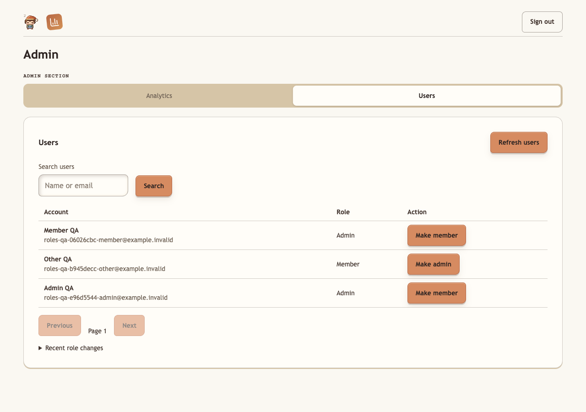

# Commons role administration

Supabase owns authentication; Cozy Commons owns authorization in
`public.commons_user_roles`. `member` is the default without an assignment.
A Commons `admin` can access analytics, manage roles, moderate Dice and Fantasy,
use Trips account linking (still requiring trip membership), and administer hosted
Crowdset. These are global privileges; there are no project-specific roles yet.

Open `/admin`, choose **Users**, search for an existing account, choose **Make
admin** or **Make member**, and confirm. Only verified accounts can be promoted.
Recent role changes shows the actor, target, old/new roles, and timestamp. The
last verified admin cannot be demoted. A stale edit returns a refresh instruction.
Demotion takes effect on subsequent protected requests without signing out.



## Release

The normal shared release runner applies `0085_dice_commons_roles.sql`. It seeds
verified, non-anonymous users who held either the existing Commons/Crowdset Auth
flags or the former Dice admin email allowlist (Jason and Matt). This runs once;
later sign-ups never inherit those legacy privileges. The migration records
initial grants in the audit history. It does not modify Auth metadata.

Deploy the shared backend/frontend and hosted Crowdset image. Crowdset needs no
new environment variables or service key. All services must use the same Supabase
project. The admin workspace's separate analytics reader setup remains necessary
for charts, but account management does not depend on that reader connection.

Rolling back to application code from before this migration restores legacy
authorization checks and may regrant access to demoted users. Prefer a forward
fix for permission issues; keep role and audit data intact.

If none of the legacy administrators exists as a verified account, a trusted
operator must bootstrap an existing verified account. There is no public or
first-signup bootstrap endpoint.

## Trusted recovery

Use a trusted database console against the intended environment. Verify the user
UUID and verified email first. Normal administration uses the UI. For recovery
when no admin remains (for example, an account was deleted through Auth admin),
use the following transaction, replacing the placeholder UUID. Preserve the
transaction and audit insert together. Do not put credentials in shell history.

```sql
BEGIN;
SELECT pg_advisory_xact_lock(873241905);
WITH candidate AS (
 SELECT id FROM auth.users
 WHERE id = 'REPLACE_WITH_VERIFIED_USER_UUID'::uuid
 AND email_confirmed_at IS NOT NULL AND is_anonymous IS NOT TRUE
), previous AS (
 SELECT c.id, coalesce(r.role, 'member') AS role
 FROM candidate c LEFT JOIN public.commons_user_roles r ON r.user_id=c.id
), changed AS (
 INSERT INTO public.commons_user_roles(user_id, role, assigned_by, updated_at)
 SELECT id, 'admin', NULL, now() FROM previous WHERE role <> 'admin'
 ON CONFLICT(user_id) DO UPDATE SET role='admin', assigned_by=NULL, updated_at=now()
 RETURNING user_id
)
INSERT INTO public.commons_role_history(user_id, old_role, new_role, source)
SELECT c.user_id, p.role, 'admin', 'recovery'
FROM changed c JOIN previous p ON p.id=c.user_id;
SELECT user_id, role FROM public.commons_user_roles
WHERE user_id = 'REPLACE_WITH_VERIFIED_USER_UUID'::uuid;
COMMIT;
```

If the final query does not show `admin`, no verified matching account was
promoted. Account deletion through trusted Supabase administration is outside the
UI's last-admin safeguard; audit UUIDs remain after deletion.

## Validation

`RUN_ANALYTICS_DB_TESTS=1 PYTHONPATH=backend python -m pytest
backend/tests/test_commons_roles_db.py -q` creates and drops its own database on
the local Supabase PostgreSQL port. It never loads dotenv or uses hosted data.
CI uses its disposable PostgreSQL service instead. API and frontend tests cover
access failures and role management; SQL tests cover real transactions and RLS.
