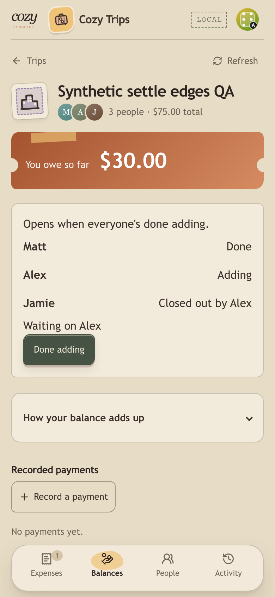
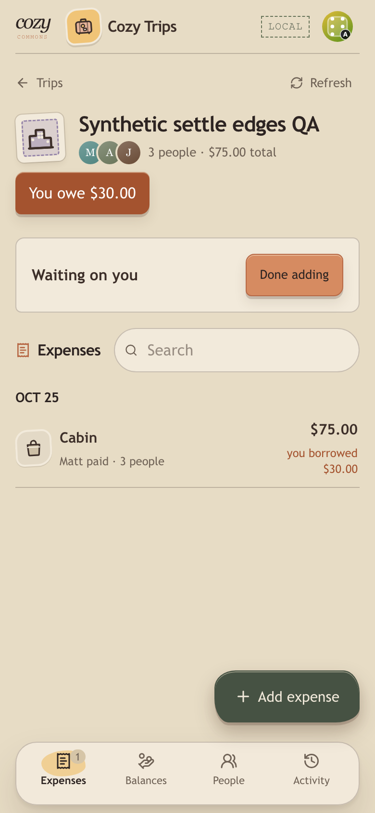
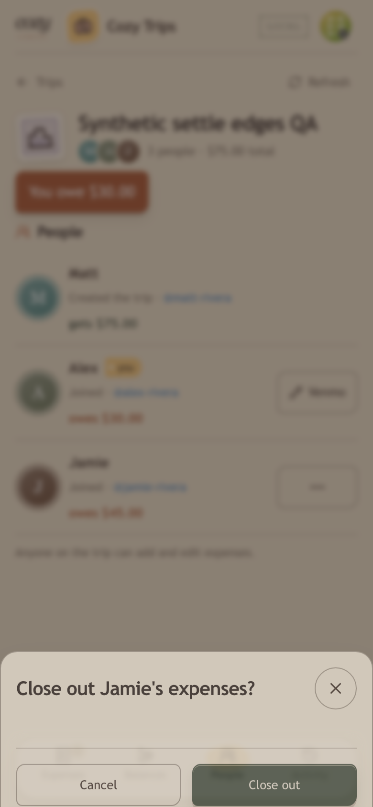
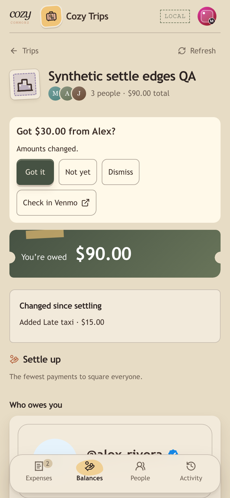
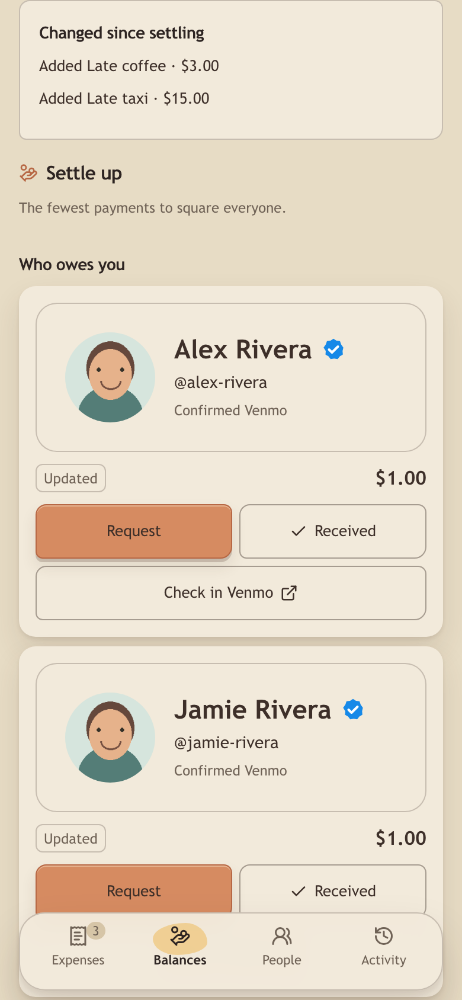

# Venmo feature map

Verified on 2026-10-25 at 390 × 844, with an additional 320 px overflow check.
All accounts, trips, profile HTML and thumbnails were synthetic. Browser checks
used the running application and loopback Supabase; outbound Venmo HTTP used
fixture responses. No payments were sent. Native Venmo app handoff on a physical
phone was not tested.

| # | Journey | Result and evidence |
| --- | --- | --- |
| 1 | Confirm Venmo | **PASS.** Typing shows the name/photo card; the fuller card shows a 112 px photo, display name and @handle. “No, it’s not” opens the live editor without confirming; reviewing the new handle asks again. Only “Yes, that’s me” confirms the displayed handle. The blue accessible “Confirmed Venmo” badge appears after Yes and disappears on a handle change. An unknown handle stays link-only, without an error wall. |
| 2 | Layered preview | **PASS.** OG-only fixture returned `source: og` and rendered a card. After restarting the preview process with upstream failures, the persisted card returned `source: cached, stale: true` and rendered quietly. A cacheless handle remained link-only. |
| 3 | Photos | **PASS.** Both list images loaded from authenticated Cozy `/venmo/photo` URLs. A fixture with an unapproved photo host returned `found: false`; no request reached that host. Host, type, size, normalization and signature-expiry tests pass. |
| 4 | Gentleness | **PASS.** Forty profile requests produced five upstream failures; after a two-second pause, a different user's uncached probe still produced no upstream call. Cached and link-only views remained usable. Clock-controlled tests cover bucket refill, jitter and single half-open probes. |
| 5 | Pay | **PASS.** The payer sheet displayed the payee card above the amount, with the blue confirmation badge only for an owner-confirmed payee. Its URL used `txn=pay`, the exact $12.34 amount, percent-encoded spaces, the trip note and the obligation reference. |
| 6 | Request | **PASS.** “Who owes you” displayed separate debtor cards for $12.34 and $56.78. Each row's Request opens the exact `txn=charge` URL for that person and amount. After settling one, the remaining debtor becomes the next row. |
| 7 | Return prompt | **PASS.** The trip owns the opened ID, cycle, amount and handle. A $30 request followed by a refresh to $45 still asks “Got $30.00 from Alex?” with “Amounts changed.” Got it records the opened $30; the remaining $15 becomes a new debt. Not yet, dismissal and navigation never settle. A missing record, changed cycle or handle invalidates the prompt; another party settling it shows who marked it. |
| 8 | Either party settles | **PASS.** Got it by the person owed and Sent by the payer each produced one repayment through the existing ledger command. The other account read the settled state and updated balances without a confirmation. Concurrent-party database coverage proves one repayment, not two. |
| 9 | Undo | **PASS.** Row Undo and toast Undo each reopened the obligation and restored the original balances. Cycle guards reject a delayed Sent retry after Undo. A third member’s legacy DELETE of an obligation-linked repayment returns 403 and preserves balances; either party can undo. |
| 10 | Check in Venmo | **PASS (web link).** Rows and prompts use exactly `https://venmo.com/u/{handle}`. Physical-phone app opening remains unverified. |
| 11 | Nudge | **PASS.** Aging only the synthetic obligations by four days exposed Nudge. A repeat request returned 422 inside 48 hours. The payer saw the banner on opening Expenses as well as Balances. |
| 12 | Regression | **PASS.** Created a synthetic trip through the UI, added an expense, exercised unequal splits and settle-up, and reopened `/dice` with its seeded matches/standings. Full backend and frontend suites, lint, production build and migration checks pass. |
| 13 | Ready-to-settle gate | **PASS.** New synthetic trips show balances “so far” and no Pay/Request before the gate starts. Done adding and Not done yet work before the start; placeholders are ignored. The last joined member becoming ready starts settling automatically. A legacy synthetic trip without state remains started. |
| 14 | Close out | **PASS.** Alex, a non-creator, opens Jamie's sheet and sees the confirm. Cancel changes nothing; Close out records Alex and shows “Closed out by Alex”. The “Waiting on you” banner appears on Alex's Expenses tab while another member is ready. |
| 15 | Creator Start now | **PASS.** On a second synthetic trip, Matt starts while both joined members are still Adding. The API records the creator member as `started_by`; repeating is a no-op. Other members cannot start. |
| 16 | Late expense after settling | **PASS.** Both debts were settled to All square. Adding $3 coffee through the expense form leaves all settled payments intact and creates two $1 obligations tagged Updated. Changed since settling lists the new expense. Removing an earlier expense creates ordinary reverse/refund obligations in backend tests. Undo of an old payment after the late change shows “Undone.” and restores its amount. |
| 17 | In-flight payment during a change | **PASS.** Opened the exact $30 Request URL, added a $15 expense while away, and returned to the captured $30 question. The old ID/ref/amount remain `replaced`; Got it writes exactly that ID and $30 through the ledger, leaving $15. Component coverage also removes the original row entirely and preserves the trip-level prompt. |

## Local validation

Use Node 22 and the repository backend virtualenv.

- `cd backend && DICE_TEST_DATABASE=1 DICE_REQUIRE_DATABASE_TESTS=1 DB_URL="$LOCAL_DICE_TEST_DB_URL" .venv/bin/python -m pytest tests -q`: **1,389 passed, 11 skipped**. The database was an allowlisted disposable loopback database, bootstrapped with `scripts/bootstrap-dice-test-db.sh`.
- `cd frontend && npm test -- --run --maxWorkers=1 --testTimeout=30000`: **593 passed across 75 files**; the serial setting avoids contention on the development machine.
- `cd frontend && npm run lint`: passed.
- `cd frontend && npm run build:check`, with synthetic loopback build configuration: passed, including the 500 KiB chunk budget.
- `scripts/check-dice-migration-contract.sh` and `scripts/check-commons-migration-contract.sh`: passed.

The 11 skips are nine opt-in Trips integration tests and two tests requiring the
locked local Dice REST API. The guarded Dice PostgreSQL tests ran against the
allowlisted disposable loopback database. Earlier standard runs skipped another
40 PostgreSQL tests; the command above enables them. No hosted database was used.

Rebased onto `origin/main` at `e804710` (#125, #127, #128 and #129). Main's Trips
spacing rules are preserved. Main's highest top-level migration is 0080, so
**0081 remains the next free number** for the Venmo public-profile cache.

Before this rebase, the reported Dice foreground-resync failure did not reproduce.
At `origin/main`
`db9608c`, both the default full frontend run and the serial full run passed
(**555 tests** each), and ten separate invocations of “coalesces foreground resync
while a canonical refresh is in flight” passed. The rebased branch full run passed all
593 tests. This stack adds no Dice implementation changes; no order dependence
was observed.

Review verification used the new synthetic “Cabin review QA” trip. It repeated
unequal splits, exact pay/request links, captured-payment settlement, settlement and
both Undo paths, nudge cooldown/banner, cached preview after a process restart,
OG/invalid-host/link-only fixtures, and request throttling.
The question card has no confirmation badge, label or divider. Pay and debtor
cards retain the badge and plain small “Confirmed Venmo” text for confirmed handles.
Tap, hover or keyboard focus on the badge shows who confirmed it; Escape or
leaving the badge dismisses the tooltip. Pay uses one title, “Pay Matt”, and
“Pay $12.34 in Venmo”. Debtor rows show the card, amount and actions without
repeating the person’s name above the card. Return questions read “Sent $12.34
to Matt?” / “Got $12.34 from Alex?”. “Check in Venmo” is an outline button
with an external-link icon; debtor cards fill their row and Request uses the same
text style as Received. These layouts passed 390 px and 320 px checks.

## Review boundaries

Migration **0081** adds only the public profile cache and its service-role grants.
The new `venmo` migration family runs in the normal release migration session.
Settling state lives in the Trips record; no migration was added. Legacy trips
without that state are already started. Generic obligations are embedded in the host's atomic record. Trips supplies
existing settle-up suggestions; the shared module does not calculate balances.
Obligation status, repayment creation/removal and ledger balances share a single
compare-and-swap write. Unmatched open records become `replaced` and retain their identity, reference,
amount and cycle. Settling an opened replaced record records its own amount;
reconciliation derives only the remaining net. The 100 most recent replaced
records are retained; settled records are never pruned.

A seeded 399-case check found that re-optimization can reshuffle other open pairs
after one payment, beyond the original probe's sample. The check asserts every
old payment ID and exact fields survive as open or replaced. It deliberately
keeps the approved re-optimization rather than pinning a payment graph.

## Screenshots

