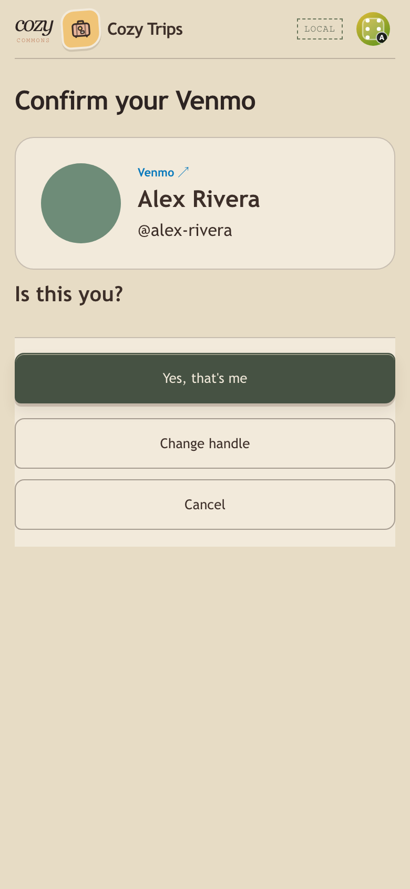
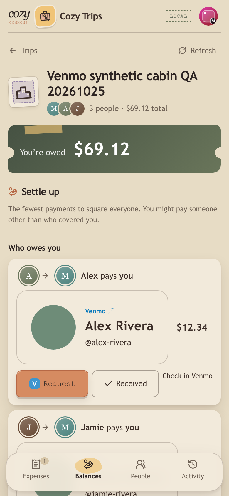
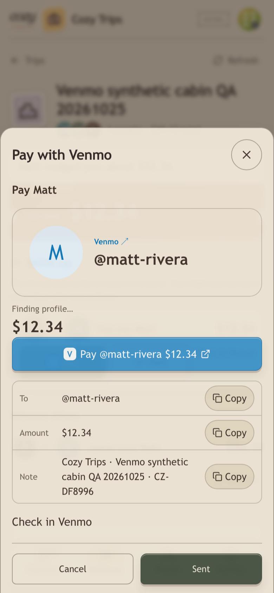
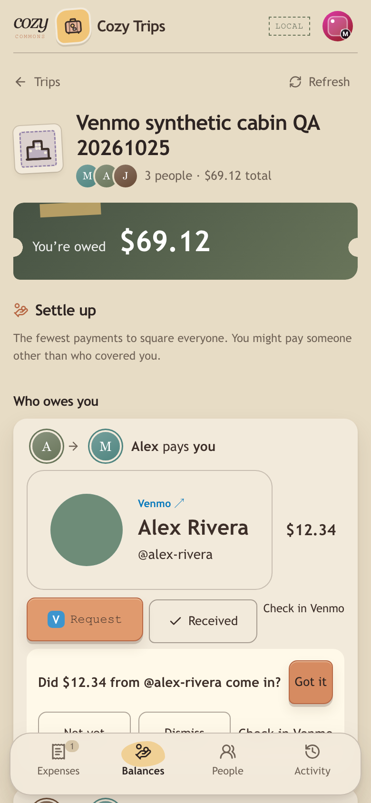
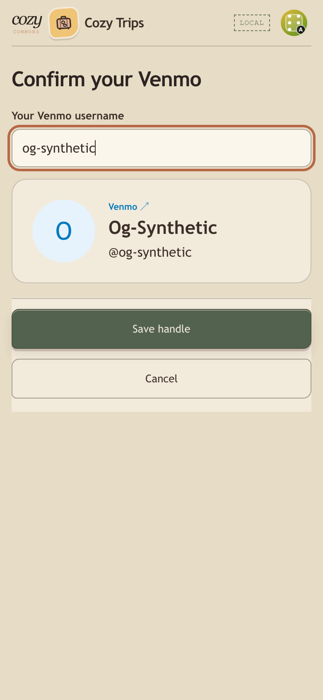

# Venmo feature map

Verified on 2026-10-25 at 390 × 844, with an additional 320 px overflow check.
All accounts, trips, profile HTML and thumbnails were synthetic. Browser checks
used the running application and loopback Supabase; outbound Venmo HTTP used
fixture responses. No payments were sent. Native Venmo app handoff on a physical
phone was not tested.

| # | Journey | Result and evidence |
| --- | --- | --- |
| 1 | Confirm Venmo | **PASS.** Typing shows the name/photo card; the initial confirmation asks “Is this you?”. Saving confirms the normalized handle. An unknown handle stays link-only, without an error wall. |
| 2 | Layered preview | **PASS.** OG-only fixture returned `source: og` and rendered a card. After restarting the preview process with upstream failures, the persisted card returned `source: cached, stale: true` and rendered quietly. A cacheless handle remained link-only. |
| 3 | Photos | **PASS.** Both list images loaded from authenticated Cozy `/venmo/photo` URLs. A fixture with an unapproved photo host returned `found: false`; no request reached that host. Host, type, size, normalization and signature-expiry tests pass. |
| 4 | Gentleness | **PASS.** Forty profile requests produced five upstream failures; after a two-second pause, a different user's uncached probe still produced no upstream call. Cached and link-only views remained usable. Clock-controlled tests cover bucket refill, jitter and single half-open probes. |
| 5 | Canary | **PASS.** Running the one-shot CLI on the good fixture printed `ok` and exited 0. Garbage printed `venmo_profile_shape_changed` with failing layers/keys and exited 1. |
| 6 | Pay | **PASS.** The payer sheet displayed the payee card above the amount. Its URL used `txn=pay`, the exact $12.34 amount, percent-encoded spaces, the trip note and the obligation reference. |
| 7 | Request | **PASS.** “Who owes you” displayed separate debtor cards for $12.34 and $56.78. Each row's Request opens the exact `txn=charge` URL for that person and amount. After settling one, the remaining debtor becomes the next row. |
| 8 | Return prompt | **PASS.** Focus return after opening Pay or Request showed the matching question. Not yet, dismissal and leaving the sheet preserved the open debt. Only Sent / Got it wrote a settlement. |
| 9 | Either party settles | **PASS.** Got it by the person owed and Sent by the payer each produced one repayment through the existing ledger command. The other account read the settled state and updated balances without a confirmation. Concurrent-party database coverage proves one repayment, not two. |
| 10 | Undo | **PASS.** Row Undo and toast Undo each reopened the obligation and restored the original balances. Cycle guards reject a delayed Sent retry after Undo. |
| 11 | Check in Venmo | **PASS (web link).** Rows and prompts use exactly `https://venmo.com/u/{handle}`. Physical-phone app opening remains unverified. |
| 12 | Nudge | **PASS.** Aging only the synthetic obligations by four days exposed Nudge. A repeat request returned 422 inside 48 hours. The payer saw the banner on opening Expenses as well as Balances. |
| 13 | Regression | **PASS.** Created a synthetic trip through the UI, added an expense, exercised unequal splits and settle-up, and reopened `/dice` with its seeded matches/standings. Full backend and frontend suites, lint, production build and migration checks pass. |

## Local validation

Use Node 22 and the repository backend virtualenv.

- `cd backend && .venv/bin/python -m pytest tests -q`: **1,314 passed, 51 skipped**.
- `cd backend && DICE_TEST_DATABASE=1 DICE_REQUIRE_DATABASE_TESTS=1 DB_URL="$LOCAL_DICE_TEST_DB_URL" .venv/bin/python -m pytest tests -q`: **1,354 passed, 11 skipped**. The database was an allowlisted disposable loopback database, bootstrapped with `scripts/bootstrap-dice-test-db.sh`.
- `cd frontend && npm test -- --run --maxWorkers=1 --testTimeout=30000`: **558 passed across 74 files**; the serial setting avoids contention on the development machine.
- `cd frontend && npm run lint`: passed.
- `cd frontend && npm run build:check`, with synthetic loopback build configuration: passed, including the 500 KiB chunk budget.
- `scripts/check-dice-migration-contract.sh` and `scripts/check-commons-migration-contract.sh`: passed.

The database-enabled LKG and concurrent-party test also passed against local
Supabase. Opt-in integration skips are reported above; no hosted database was used.

## Review boundaries

Migration **0081** adds only the public profile cache and its service-role grants.
The new `venmo` migration family runs in the normal release migration session.
Generic obligations are embedded in the host's atomic record. Trips supplies
existing settle-up suggestions; the shared module does not calculate balances.
Obligation status, repayment creation/removal and ledger balances share a single
compare-and-swap write. Concurrent edits can invalidate a suggestion, which then
requires refreshing before another explicit settle.

## Screenshots

